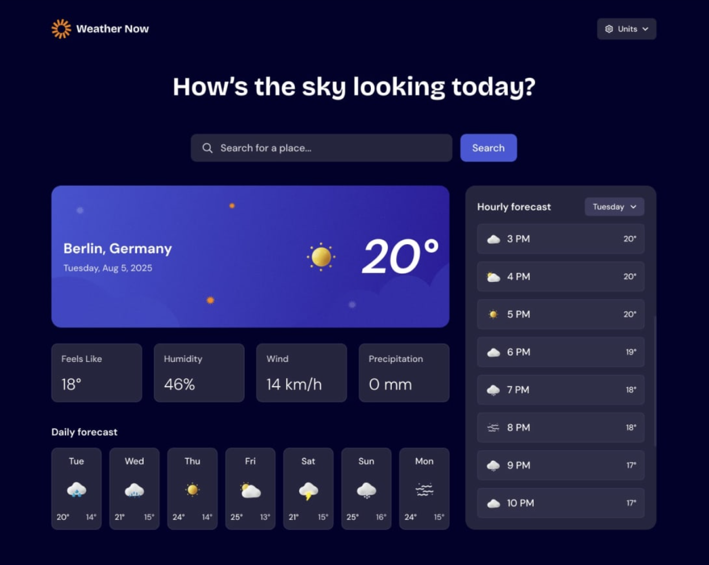

# Weather App

Aplicação de previsão do tempo que busca cidades e mostra as condições atuais e a previsão por hora e por dia, com
dados reais da API Open-Meteo. Baseada no desafio _Weather app_ do Frontend Mentor.

**Demonstração:** [weather-app-kohl-nine-46.vercel.app](https://weather-app-kohl-nine-46.vercel.app)



## Objetivo

Praticar o consumo de uma API pública em React: requisições assíncronas, estados de carregamento e de erro e
organização do código em componentes, contexto e serviços.

## Funcionalidades

- Busca de cidade pelo nome (geocodificação da Open-Meteo).
- Clima atual: temperatura, sensação térmica, umidade, vento e precipitação.
- Previsão diária e previsão por hora, com escolha do dia.
- Troca de unidades: Celsius/Fahrenheit, km/h/mph e milímetros/polegadas.
- Esqueletos de carregamento enquanto os dados chegam.
- Mensagem para busca sem resultado e tela de erro com opção de tentar novamente.
- Layout responsivo.

## Tecnologias

- React (JavaScript)
- Vite
- Tailwind CSS
- Context API
- [Open-Meteo](https://open-meteo.com/) — previsão do tempo e geocodificação (pública, sem chave de API)

## Como executar localmente

```bash
git clone https://github.com/Richard-coding/weather-app.git
cd weather-app
npm install
npm run dev
```

Acesse `http://localhost:5173`. Para gerar a versão de produção: `npm run build`.

## Status

Concluído como projeto de estudo.

## Créditos e autoria

- Design e recursos visuais: desafio Weather app do [Frontend Mentor](https://www.frontendmentor.io); a pasta
  `design/` traz as referências originais.
- Desenvolvimento: Richard Soares Mesquita — [GitHub](https://github.com/Richard-coding).
